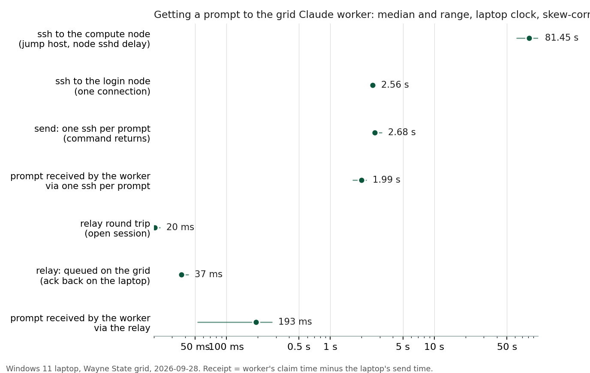

# Ashley: architecture

Ashley is three small things that agree on one file format.

| Piece | Runs on | Language | Job |
|---|---|---|---|
| VS Code extension (`extension/`) | the student's laptop, inside VS Code | TypeScript | wizard, secrets, Remote-SSH, the Ashley view, "Ask", MCP registration |
| MCP server (`extension/dist/mcp-server.js`) | the laptop, spawned by Claude Code | TypeScript (bundled) | gives the local Claude the `ashley_*` tools |
| Grid CLI + daemon (`grid/`) | the grid: `ashley` on the login node, `ashleyd.js` inside a container on a compute node | bash, Node | install, workers, the request queue, Claude Code itself |

Everything the laptop does on the grid is `ssh wsu-grid ~/.ashley/bin/ashley <verb>`. There is no
port, no tunnel and no server on the laptop; nothing on the login node beyond `sbatch`, `squeue`,
`cat`, `ls` and a half-second sleep loop.

## Topology

```
laptop                       warrior (login node)                compute node (Slurm job)
──────                       ────────────────────                ────────────────────────
VS Code ─ Ashley ext ──ssh──▶ ~/.ashley/bin/ashley ──files──▶  apptainer exec node22-bookworm
Claude Code ─ MCP ─┘          (bash: install, status,           └─ node ashleyd.js
Remote-SSH ─────────ProxyJump──────────────────────────────────▶   └─ claude -p ... (2.1.283)
                              sbatch / squeue                        watches  workers/<w>/inbox
                                                                     writes   workers/<w>/outbox
                              shared home: ~/.ashley/{accounts,sessions,workers}
                              CephFS ROOT: containers/, npm/, workspaces/
```

The login node is a jump host. VS Code Remote-SSH connects to `voh3.nas.grid.wayne.edu`
(any node where the student holds a job) through `ProxyJump wsu-grid`; C&IT forbids the VS Code
server on `warrior` and kills it there. Compute nodes have internet, so Claude Code, `npm`,
Hugging Face and Zenodo all work from inside the job.

## The request queue

A request is a JSON file. Its life:

1. The laptop writes `~/.ashley/workers/<w>/inbox/<id>.json` through `ashley send` (stdin,
   `.part` then rename, so the daemon never reads a half-written file).
2. `ashleyd.js` polls the inbox every second, claims the file by renaming it to
   `<id>.json.claimed` (an atomic operation on the shared filesystem; two daemons cannot both win).
3. It picks a credential (below), resolves the session, and spawns
   `claude -p <prompt> --output-format stream-json --verbose --permission-mode <mode> --max-turns N [--resume <sid> | --session-id <uuid>]`
   in the session's working directory, with `CLAUDE_CONFIG_DIR=~/.ashley/accounts/<account>`.
4. Every stream-json line is appended to `outbox/<id>.events.jsonl` as it arrives. `ashley wait --stream`
   tails that file to the laptop as `EVENT {…}` lines, so VS Code shows tool calls live.
5. On exit, the daemon writes `outbox/<id>.json` (`.part` then rename): status, result text,
   session id, account, cost, turns, duration, node, job. `ashley wait` prints it as `RESULT {…}`.

### How a prompt travels, and how fast

The laptop keeps **one ssh session** to the login node open, running `ashley relay`. A prompt
is one line on that session's stdin; the relay writes the inbox file and answers `QUEUED`; the
daemon polls the inbox every 250 ms; results and events come back on the same session as
`RESULT`/`EVENT` lines. Measured on 2026-09-28 (Windows laptop, skew-corrected; `docs/research/`):

| Path | Median | Range |
|---|---|---|
| one ssh connection to the login node | 2.6 s | 2.4 to 2.7 s |
| prompt received by the worker, one ssh per prompt (the first design) | 2.0 s | 1.6 to 2.2 s |
| relay round trip | 20 ms | 18 to 23 ms |
| relay: queued on the grid, ack on the laptop | 37 ms | 35 to 43 ms |
| **prompt received by the worker via the relay** | **0.19 s** | 0.05 to 0.28 s |
| ssh straight to the compute node (for comparison) | about 25 s | the node's sshd delay |



So the relay is roughly ten times faster to receipt and the remaining 0.1 to 0.3 s is the
daemon's poll interval. It is "UDP-like" in the sense that matters (no per-message handshake,
fire-and-forget `send` with an ack in 40 ms) while staying reliable: the file is the message,
and a dropped session loses nothing that was already queued. If the session drops, the next
call reconnects; every call also falls back to a fresh ssh. True UDP to the node is impossible
(the laptop cannot reach compute nodes) and unnecessary. Claude Code's own start-up (about 5 s
cold) now dominates the time to a first token; a warm `--input-format stream-json` process
per session is the next lever if that ever matters.

A queued request survives a daemon restart, a requeued job or a closed laptop: the daemon
moves any `.claimed` file back to the inbox when it starts. An interactive ssh to the login
node or the node (Remote-SSH, `Ashley: Open a terminal on the grid login node`) remains
available; it is simply not the path prompts take.

Why not a socket or a TCP port: the laptop can only reach the login node; the daemon runs on
whichever node Slurm chose; the shared home is the one thing both see. Files are also what a
student can debug with `ls` and `cat`.

## Sessions

`~/.ashley/sessions/<name>.json` maps a name the student chose ("thesis", "figure-2") to a
Claude Code session id, the working directory it is bound to and the account that owns it. The
first turn of a session passes `--session-id <uuid>` so the id is known even if the run dies;
later turns pass `--resume <uuid>`. Claude Code keeps the transcript under
`<CLAUDE_CONFIG_DIR>/projects/<encoded cwd>/<uuid>.jsonl`, which is why a session stays bound to
its directory.

## Credentials

Each `~/.ashley/accounts/<name>/` is both a credential and a `CLAUDE_CONFIG_DIR`, so accounts
never share sessions, settings or caches:

- `token`: a long-lived subscription token from `claude setup-token` (the normal case). Exported
  to Claude Code as `CLAUDE_CODE_OAUTH_TOKEN`.
- `apikey`: an Anthropic API key (pay-per-use overflow). Exported as `ANTHROPIC_API_KEY`.
- `.credentials.json`: a copied interactive login. Works until its refresh token dies; not
  recommended (the probe on 2026-09-28 showed a copy rejected after eight idle days).

Order of use: subscriptions before API keys, `default` first. When a run ends with an error that
matches the limit patterns in `protocol.ts` ("hit your limit", "rate_limit", "429", ...), the
account gets `state.json` with `cooldown_until` (the reset time Claude printed, else one hour), the
request is re-queued for the next enabled account, and if none is left the result is written
with `status: rate_limited` and `retry_after`. The worker's heartbeat reports `blocked` with
`blocked_until` so the laptop can say "your window resets at 3 pm" instead of failing.

One person, one token. Pooling several people's subscriptions into one worker would breach the
Consumer Terms (each account is for the person who holds it); the rotation exists for a student's
own second credential, typically an API key with a spending cap.

## Secrets: where they are and where they are not

| Secret | Laptop | Grid | Never |
|---|---|---|---|
| GitHub, Hugging Face tokens | VS Code SecretStorage (OS keychain); injected into integrated terminals | `~/.ashley/secrets.env` (mode 600), read by the daemon into the worker's environment | job logs, `sbatch --export`, command lines |
| Claude subscription token | SecretStorage | `~/.ashley/accounts/default/token` (600) | laptop terminals |
| Anthropic API key | SecretStorage | `~/.ashley/accounts/apikey/apikey` (600) | laptop terminals (it would silently switch the local Claude Code to pay-per-use) |
| Grid password / OTP | nowhere | nowhere | typed once, in a terminal, to install the SSH key |

Files travel over ssh **stdin** (`cat > file` with `umask 077`), never as arguments.

## The container

`bootstrap.sbatch` (one job per user, 7 minutes measured) builds an unprivileged Apptainer
**sandbox directory** from `docker://node:22-bookworm` on the student's CephFS space and installs
`@anthropic-ai/claude-code@2.1.283` into a persistent npm prefix there. A sandbox rather than a
`.sif`: SIF-to-sandbox conversion at exec time is what failed on this grid before, and several
nodes lack `unsquashfs`. The host is CentOS 7 (glibc 2.17); Claude Code needs Node 22, which needs
a newer glibc, hence the container (glibc 2.36 inside). Runtime order tried:
`module load apptainer/1.2.2` (worked on `asx1`), the conda `singularity` 3.8.6, `module load
singularity/3.5.2`, `/usr/bin/apptainer`. `~/.local/bin/singularity` is skipped on purpose.

The worker job (`worker.sbatch.tpl`) execs the daemon inside the sandbox with `$HOME`, the
CephFS tree and a `/dev/shm` scratch bound to `/tmp` (`/tmp` on nodes is swept by a cleaner
while jobs run). `--signal=B:TERM@120` gives the daemon two minutes to finish a turn at the wall
limit; `--dependency=singleton` keeps one job per worker name; on the `requeue` QoS the job is
`--requeue --open-mode=append` because the daemon is re-entrant.

## The shared container library

Containers are read-only at run time (every account's sessions, settings and caches live in its
own home), so one copy serves the whole lab. `/rs/rs_grp_oschome/shared/ashley/` (group
`oschome`, mode 2775) holds `library.json` and one sandbox per entry:

```json
{"version": 1, "default": "claude-node22",
 "containers": {"claude-node22": {"sandbox": ".../containers/claude-node22", "claude_bin": ".../npm-claude-node22/bin/claude",
   "runtime": "/wsu/el7/gnu7/apptainer/1.2.2/bin/apptainer", "image": "docker://node:22-bookworm",
   "claude_version": "2.1.283 (Claude Code)", "gpu": false, "built": "...", "built_by": "go2432", "purpose": "general ..."}}}
```

- `ashley install` adopts the library's default when it is readable (`ashley adopt <name>` writes
  `config.env` and `READY` in a second; nothing is built, nothing is stored in the student's
  space). `ashley install --build-own` keeps the old per-account build.
- `ashley worker start --container <name>` runs any entry; the worker's job script carries the
  sandbox and binds the library root. A student can run a CPU worker on the general container and
  a GPU worker on a CUDA one at the same time.
- Leads publish entries with `ashley library publish --name <name> --image docker://<image>
  [--gpu] [--purpose "..."]`: a job builds the sandbox, installs the pinned Claude Code, merges the
  entry into `library.json` and makes the tree group-readable. Entries are pinned by image and
  Claude Code version, so every student runs the same bits; an update is a new entry.
- Access: membership of the `oschome` group (the lab asks the HPC admins). Without it, the wizard
  falls back to building in the student's own storage, so nothing blocks.

Because every worker of an account shares `~/.ashley`, a worker Claude can hand work to another
worker with `ashley send --worker <name>` from its shell; the daemon tells each worker who it is,
which peers are alive and the exact command (`peerNote()` in `ashleyd.js`). A lead worker on the
general container can therefore fan out to a GPU worker on a CUDA container and collect the result
with `ashley result`.

## The laptop side

- **Wizard** (`core/wizard.ts`): nine steps, each with `check()` and `run()`, over an abstract
  `WizardEnv` (settings, secrets, UI). The VS Code extension and the terminal CLI plug in their
  own UI. Rerunning does only what is missing.
- **SSH config** (`core/sshConfig.ts`): one managed block between markers, inserted first so it
  wins over any `Host *`. `MACs +hmac-sha1` because the grid's sshd offers nothing newer to
  Windows OpenSSH 9.5; `AddressFamily inet` because on Windows the IPv6 attempt to the login
  node times out first (13 s per connection measured, 2 s with IPv4 only);
  `IdentitiesOnly` so the agent's other keys are not tried; a wildcard
  `Host *.nas.grid.wayne.edu` with `ProxyJump` so no per-node edit is ever needed. On Windows the
  same block and key are mirrored into WSL.
- **Interactive steps** open a VS Code terminal whose *process* is `ssh` or `claude` (no shell,
  no quoting) and read its exit status.
- **Environment**: `environmentVariableCollection` (persistent) rather than editing
  `terminal.integrated.env` settings, so it can be cleared and does not leak into settings sync.
- **MCP**: `claude mcp add-json --scope user` with the server run by system `node` (>= 20) or by
  VS Code's own Electron with `ELECTRON_RUN_AS_NODE=1`, so students need not install Node.
  Fallback: `.mcp.json` in the workspace.

## Xcode and other editors

`core/` never imports `vscode`. `dist/ashley-cli.js` runs the same wizard and the same grid calls
from a terminal; `cli/ashley` is a ten-line ssh forwarder for machines without Node. The MCP
server is editor-agnostic: any client that speaks MCP over stdio (Claude Code in Xcode's
terminal, Claude Desktop, an Agent SDK script) can register it. A native Xcode extension is the
wrong layer: Xcode Source Editor Extensions cannot open terminals, store secrets or run
processes; the CLI plus MCP is the port.

## What is deliberately not here

- No Nextflow yet. The queue and the worker are the substrate a pipeline can call
  (`ashley send` from a Nextflow process, `ashley result` in the next); the recipe's Nextflow
  section stays the plan.
- No shared lab account, no cross-student pooling.
- No X11. Remote-SSH renders images; `srun --x11` remains available for the rare tool that needs
  a display.
